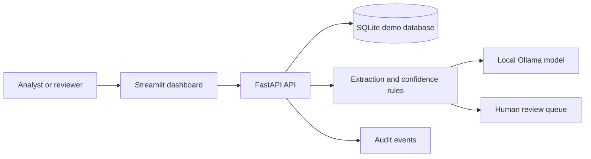

# DocSure: Regulated Document Intelligence Platform

DocSure is a local portfolio demo for processing regulated documents safely. It accepts synthetic text PDFs or TXT files, extracts structured fields with a local model, calculates confidence, routes uncertain results to a reviewer, scopes records by tenant, and writes audit events for each important operation.

> All data, users, tenants, documents, and policies in this repository are synthetic. DocSure is a local demo, not a production deployment or a real compliance system.

## Customer problem

Teams in regulated industries must extract fields from incoming documents while preserving traceability and review controls. Fully automatic extraction is risky because a missing or inaccurate field can affect a downstream decision. Teams need a workflow that highlights uncertain results, separates tenants, and records reviewer decisions.

## What DocSure demonstrates

- Document upload and text-PDF extraction.
- Local AI structured extraction with Ollama and Qwen 2.5.
- Confidence scoring and a mandatory review threshold.
- Reviewer correction and approval workflow.
- Multi-tenant scoping by `tenant_id`.
- Role-based workflow boundaries: analyst, reviewer, and admin.
- Audit events for uploads, extraction, and reviewer actions.
- Docker Compose and Kubernetes deployment scaffolding.
- Security and operations documentation.

## Architecture



## Technology stack

| Layer | Tools |
| --- | --- |
| Dashboard | Streamlit |
| API | FastAPI and Pydantic |
| Database | SQLite for the local demo |
| PDF text extraction | PyMuPDF |
| Local AI | Ollama with Qwen 2.5 |
| Local containers | Docker Compose |
| Kubernetes scaffold | Helm chart in `deploy/helm/docsure` |

## Demo users

| User | Tenant | Role | Allowed workflow |
| --- | --- | --- | --- |
| Asha Analyst | `northstar-health` | analyst | Upload and view only the tenant's documents. |
| Ravi Reviewer | `northstar-health` | reviewer | Review low-confidence documents and read tenant audit events. |
| Mina Compliance Admin | `northstar-health` | admin | Review documents and read tenant audit events. |
| Leo Analyst | `harbor-clinic` | analyst | Demonstrates a second tenant with separate documents. |

The identity selector is a **demo substitute for SSO**. A production platform would derive the identity, role, and tenant from a verified login token rather than allow a user selection.

## Confidence and review policy

DocSure assigns a confidence score after extraction. Documents below `85%` go to a reviewer queue. An explicit source warning such as “pending verification” always lowers confidence; an AI-generated value cannot bypass that rule.

This is a simple but important design choice: confidence is a signal for review, not proof that a model is correct.

## Run locally on Windows

Prerequisites: Python 3.12 or compatible, VS Code, and Ollama with `qwen2.5:1.5b` installed.

Install dependencies:

```powershell
.\.venv\Scripts\python.exe -m pip install -r requirements.txt
```

Start the API:

```powershell
.\.venv\Scripts\python.exe -m uvicorn api:app --reload --port 8002
```

In a second terminal, start the dashboard:

```powershell
.\.venv\Scripts\python.exe -m streamlit run dashboard.py --server.port 8503
```

Open <http://localhost:8503>. API documentation is at <http://127.0.0.1:8002/docs>.

## Demo flow

1. Select **Asha Analyst**.
2. Upload `sample_invoice.txt` to see a high-confidence extraction.
3. Upload `sample_low_confidence_invoice.txt` to trigger review.
4. Select **Ravi Reviewer**.
5. Open the review queue, correct fields if needed, and save an approval decision.
6. Open the audit log to show the trace of upload, extraction, and review.

## Container demo

The local container setup stores the SQLite database in a Docker volume and accesses Ollama through Docker Desktop's `host.docker.internal` address.

```powershell
docker compose up --build
```

Open <http://localhost:8503>. Stop containers with `Ctrl+C`; use `docker compose down` to stop them while keeping the named database volume.

## Security and operations docs

- [Security notes](docs/SECURITY.md)
- [Operations runbook](docs/RUNBOOK.md)
- [Helm deployment scaffold](deploy/helm/docsure/README.md)

## Current limits and future work

- Scanned-image OCR is not yet implemented; this MVP reads text PDFs and TXT files.
- The local AI model can produce inaccurate fields, so reviewer controls remain mandatory.
- SQLite and the identity selector are local-demo choices. Production needs managed storage, SSO, RBAC enforcement, encryption, backups, and monitoring.
- The Helm chart is a deployment scaffold. It is not a production-certified regulated-system deployment.
- Future work: OCR, field-level provenance, PostgreSQL, immutable audit storage, secret management, automated evaluation, CI/CD, observability dashboards, and cloud infrastructure modules.
